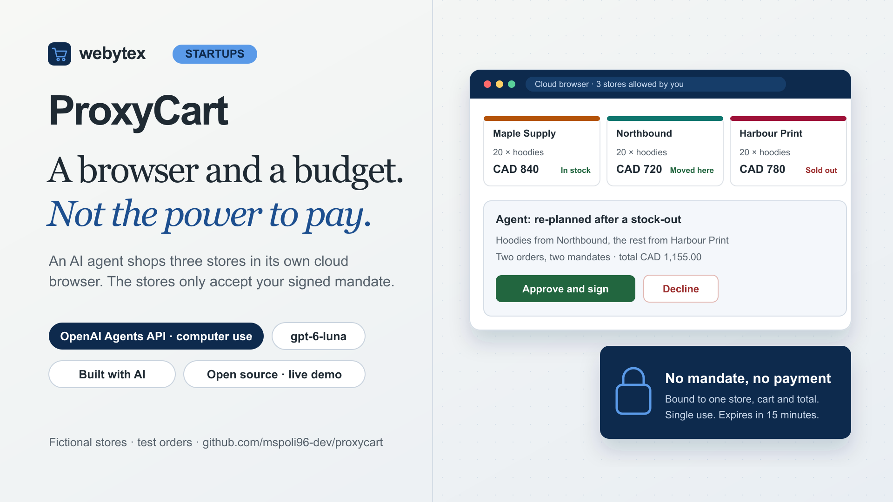

# ProxyCart

**A browser and a budget. Not the power to pay.** An agent-safe checkout demo by [Webytex for Startups](https://startups.webytex.com/#quick-contact).

ProxyCart sends an OpenAI agent with its own cloud browser into three fictional stores. It compares prices, signs in for team pricing and builds the carts, then stops and asks the buyer. The stores refuse payment unless the buyer issued a signed, single-use mandate for that exact cart and total.

[Try the demo](https://webytex-proxycart.vercel.app/) · [Read the architecture](docs/ARCHITECTURE.md) · [Inspect the validation](docs/VALIDATION.md)



## What happens in a run

1. **The mission.** Buy 20 hoodies, 20 insulated tumblers and 20 A5 notebooks for new hires, within CAD 1,250 including shipping, arriving within four business days.
2. **You allow each store.** The agent works in an OpenAI-hosted browser whose network only reaches the three store hosts. Before it opens each one, you get an approval request.
3. **It signs in without seeing the password.** Harbour Print shows team prices only to signed-in buyers. When the agent reaches the sign-in form it raises a browser-authentication request, and ProxyCart sends the demo account straight into the browser. The values never enter the model's context. Without team pricing, no basket fits the budget.
4. **It proposes, code checks.** The agent calls a `request_purchase_approval` function with its carts. ProxyCart recomputes every price, stock level, delivery estimate and total from the store catalogues, compares the plan with the cheapest compliant plan, and shows you both.
5. **You approve one exact plan.** Approval issues one HMAC-signed mandate per store, bound to the run, store, cart contents and total, valid for 15 minutes and usable once.
6. **The store enforces it.** At checkout the store server re-prices the cart, verifies the mandate and marks it as used. A changed cart, another store, a reused or forged code, or an expired mandate is refused and logged.

You can also arm a stock-out, so hoodies sell out at whichever store the agent first tries to pay for them, or lower the budget below anything possible. A recorded run shows what the agent did in each case.

This is a public demonstration with fictional stores, products and prices. Orders are test orders and no money moves. It shows a pattern for agent-safe checkout; it is not a payments integration or a compliance claim.

## Why the store holds the final check

OpenAI's computer-use guidance notes that approving a site does not confirm each action the agent takes there, and recommends restricting the resource itself for purchases. ProxyCart follows that advice literally: the prompt asks the agent to wait for approval, but the system does not rely on it. Without a valid mandate, the checkout endpoint rejects the order whatever the page or the model says.

The same split applies to arithmetic. The agent reports its own prices and totals; ProxyCart ignores them for every decision and shows both when they differ.

## Run locally

Use Node.js 24 and npm. Recorded runs, the stores and the tests work without any provider key.

```powershell
npm ci
npm run dev
```

Open [127.0.0.1:3280](http://127.0.0.1:3280). Locally the stores are served at `/stores/maple`, `/stores/northbound` and `/stores/harbour`; in production each has its own host so that every store is a separate origin.

```powershell
npm run typecheck
npm test
npm run build
```

Tests use an in-memory store, a fake agent and the real admission Lua script; they never call the paid API.

The release passed 43 tests across four files, type checking and the production build. Three real agent sessions are recorded in the app, and hosted checks covered browser verification, exact origin, edge rate limiting, store isolation and refused checkouts. See [validation evidence and limits](docs/VALIDATION.md).

Live runs need server-side credentials: an OpenAI key with Agents API access, a signing secret of at least 32 characters, Redis (`UPSTASH_REDIS_REST_URL/TOKEN` or Vercel's `KV_REST_API_URL/TOKEN`) and the exact application origin. Hosted live runs also require BotID and confirmed edge rate limiting. Copy `.env.example` to an ignored `.env.local`, supply values through your credential manager, and keep `PROXYCART_LIVE_ENABLED=false` until the controls are real. The live hosted browser cannot reach `localhost`, so live runs only work against publicly deployed stores.

`scripts/record-run.mts` is a separate **paid** tool that runs a real session against the deployed stores and writes `src/data/recorded-runs.json` and screenshots under `public/recorded/`. Review your spending allowance before executing it.

## Stack and boundaries

Next.js 16 with `proxy.ts` host routing, React 19, TypeScript, the OpenAI Agents API with computer use and `gpt-6-luna`, Zod, Upstash Redis, Vercel BotID and Vitest.

Live runs make a non-refundable USD 0.40 reservation against a USD 6 monthly application allowance, with daily limits per visitor and overall, one concurrent live run and a ten-minute limit. These are conservative application counters, not a measurement of billed cost. Sessions are deleted when a run ends. Run records, decisions and store logs expire from Redis after three hours.

The implementation was developed with AI coding assistance and human direction and review. It uses new application code and fictional data, not client systems.

## License and contact

[MIT](LICENSE). Dependencies retain their own licenses. OpenAI does not sponsor or endorse this demo.

Building something agents will use? [Talk to Webytex for Startups](https://startups.webytex.com/?utm_source=proxycart&utm_medium=github&utm_campaign=open-source#quick-contact).
